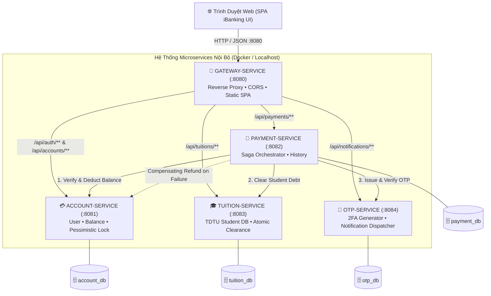
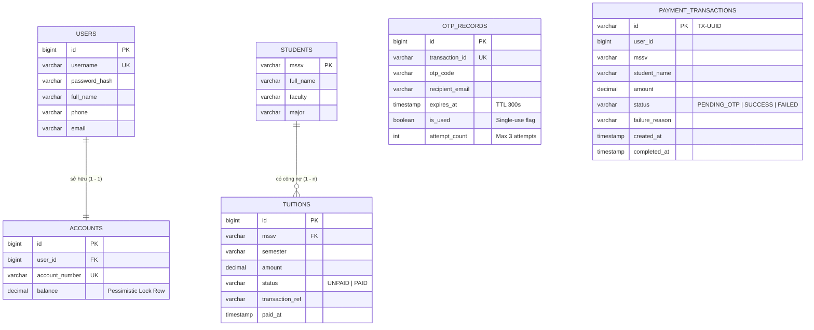
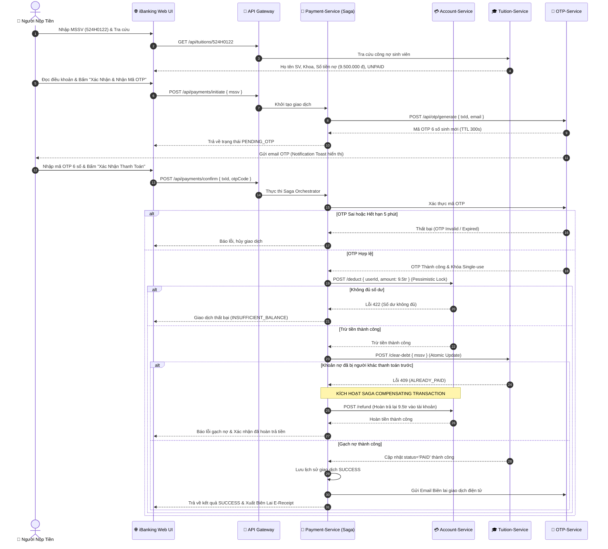

# 🏦 Phân Hệ Đóng Học Phí iBanking (TDTU) — Kiến Trúc Hướng Dịch Vụ (SOA Microservices)

<p align="center">
  
  
  
  
  
  
  
</p>

---

> 🏛️ **TRƯỜNG ĐẠI HỌC TÔN ĐỨC THẮNG (TDTU) — KHOA CÔNG NGHỆ THÔNG TIN**  
> 📚 **Học phần:** Kiến Trúc Hướng Dịch Vụ (SOA — Mã môn: `CS504070`) — Học kỳ 1 (Năm học 2026–2027)  
> 👨‍🏫 **Giảng viên hướng dẫn:** Thầy Dương Hữu Phúc  
> 👥 **Nhóm sinh viên thực hiện:**  
> - **Nguyễn Anh Quân** — MSSV: `524H0122`  
> - **Nguyễn Hồng Quân** — MSSV: `524H0123`  

---

## 📑 Mục Lục
1. [Giới Thiệu Đề Tài](#1-giới-thiệu-đề-tài)
2. [Kiến Trúc Microservices (SOA Architecture)](#2-kiến-trúc-microservices-soa-architecture)
3. [Mô Hình Dữ Liệu Phân Tán (Database-per-Service & ERD)](#3-mô-hình-dữ-liệu-phân-tán-database-per-service--erd)
4. [Đặc Tả Danh Mục REST API](#4-đặc-tả-danh-mục-rest-api)
5. [Quy Trình Nghiệp Vụ & Saga Distributed Transaction](#5-quy-trình-nghiệp-vụ--saga-distributed-transaction)
6. [Xử Lý Tương Tranh & Tính Nhất Quán (Concurrency Control)](#6-xử-lý-tương-tranh--tính-nhất-quán-concurrency-control)
7. [Bảo Mật 2FA OTP & Cơ Chế Giả Lập Email](#7-bảo-mật-2fa-otp--cơ-chế-giả-lập-email)
8. [Dữ Liệu Mẫu Kiểm Thử (Seed Data)](#8-dữ-liệu-mẫu-kiểm-thử-seed-data)
9. [Hướng Dẫn Tải Về & Khởi Động (Dành Cho Mọi Thiết Bị)](#9-hướng-dẫn-tải-về--khởi-động-dành-cho-mọi-thiết-bị)
10. [Kiểm Thử Tự Động Hóa (Automated Concurrency Testing)](#10-kiểm-thử-tự-động-hóa-automated-concurrency-testing)

---

## 1. Giới Thiệu Đề Tài

Hệ thống mô phỏng phân hệ đóng học phí của ứng dụng Ngân hàng số **iBanking TDTU**. Ứng dụng cho phép người dùng sử dụng số dư trong tài khoản thanh toán để chi trả toàn bộ 100% khoản nợ học phí của sinh viên Đại học Tôn Đức Thắng (cho chính mình hoặc thanh toán hộ người khác).

### 5 Quy trình nghiệp vụ cốt lõi theo đề bài:
1. **Đăng nhập & Thông tin người dùng:** Xác thực bằng `username`/`password`, quản lý Họ tên, Số điện thoại, Email, Số dư khả dụng và Lịch sử giao dịch.
2. **Tra cứu & Màn hình thanh toán:**
   - **Nhóm a (Người nộp tiền):** Lấy tự động từ tài khoản đăng nhập, **Read-only** (người dùng không được sửa).
   - **Nhóm b (Thông tin học phí):** Nhập MSSV, hệ thống **tự động tra cứu** hiển thị Họ tên SV, Khoa, Kỳ học, Số tiền nợ. Chỉ thu 100% trọn gói, không thu một phần.
   - **Nhóm c (Thông tin thanh toán):** Hiển thị số dư hiện tại, số tiền cần thanh toán, quy chế điều khoản. Nút Xác nhận chỉ sáng khi khoản nợ tồn tại, chưa thanh toán và số dư đủ chi trả.
3. **Xác thực 2FA OTP:** Sinh mã ngẫu nhiên 6 số gửi qua email người nộp; gắn với giao dịch cụ thể, không trùng mã đang hiệu lực, thời hạn tối đa 5 phút, chỉ dùng thành công 1 lần.
4. **Xử lý giao dịch thành công:** Kiểm tra lại số dư, trừ tiền tài khoản, gạch nợ học phí TDTU, lưu lịch sử giao dịch, gửi email biên lai, xuất biên lai điện tử E-Receipt.
5. **Đảm bảo tính nhất quán (Concurrency):** Xử lý triệt để 2 kịch bản tranh chấp đồng thời: Nhiều giao dịch trên 1 tài khoản (Chống Double Spending) và Nhiều tài khoản nộp cùng 1 MSSV (Chống Double Payment).

---

## 2. Kiến Trúc Microservices (SOA Architecture)

Hệ thống được thiết kế theo mô hình **Microservices Architecture** chuẩn SOA với 5 phân hệ dịch vụ độc lập:



| Service | Port | Database | Trách Nhiệm Nghiệp Vụ Chính |
| :--- | :---: | :---: | :--- |
| **`gateway-service`** | `8080` | *None* | Cổng giao tiếp duy nhất (Single Entry), định tuyến reverse proxy, CORS, phục vụ giao diện Web SPA. |
| **`account-service`** | `8081` | `account_db` | Xác thực đăng nhập, quản lý user, số dư tài khoản & khóa ghi Pessimistic Lock chống âm tiền. |
| **`payment-service`** | `8082` | `payment_db` | Điều phối giao dịch phân tán (Saga Orchestrator), lưu lịch sử giao dịch, kích hoạt bồi hoàn hoàn tiền. |
| **`tuition-service`** | `8083` | `tuition_db` | Cơ sở dữ liệu sinh viên TDTU, tra cứu học phí, gạch nợ nguyên tử (`Atomic Update`). |
| **`otp-service`** | `8084` | `otp_db` | Sinh OTP ngẫu nhiên (5 phút, dùng 1 lần), kiểm soát brute-force, ghi log email & biên lai. |

---

## 3. Mô Hình Dữ Liệu Phân Tán (Database-per-Service & ERD)

Mỗi service sở hữu cơ sở dữ liệu riêng biệt nhằm đảm bảo tính độc lập (**Loose Coupling**) và toàn vẹn dữ liệu:



---

## 4. Đặc Tả Danh Mục REST API

Toàn bộ API được thiết kế theo chuẩn **RESTful Maturity Level 2/3**, định dạng dữ liệu `JSON` và cấu trúc phản hồi chuẩn hóa:
```json
{
  "success": true,
  "message": "Thông báo kết quả",
  "data": { ... },
  "timestamp": "2026-11-15T22:00:00"
}
```

### 1. Phân hệ Tài Khoản & Định Danh (`account-service` :8081)
| Method | Endpoint URI | Tham Số / Body | HTTP Status | Mô Tả |
|:---:|:---|:---|:---:|:---|
| `POST` | `/api/auth/login` | `{ username, password }` | `200`, `401` | Đăng nhập tài khoản iBanking, trả về JWT Token & User Info. |
| `GET` | `/api/accounts/me` | *Header: Authorization* | `200`, `401` | Lấy thông tin người nộp (Họ tên, SĐT, Email, Số dư khả dụng). |
| `POST` | `/api/accounts/internal/deduct` | `{ userId, amount, transactionId }` | `200`, `422` | Trừ tiền số dư với **Khóa bi quan (Pessimistic Lock)**. |
| `POST` | `/api/accounts/internal/refund` | `{ userId, amount, transactionId }` | `200` | Giao dịch bồi hoàn (Saga Compensation) hoàn tiền khi gạch nợ lỗi. |
| `POST` | `/api/accounts/internal/reset` | *None* | `200` | Khôi phục số dư tài khoản về giá trị mẫu ban đầu. |

### 2. Phân hệ Học Phí TDTU (`tuition-service` :8083)
| Method | Endpoint URI | Tham Số / Body | HTTP Status | Mô Tả |
|:---:|:---|:---|:---:|:---|
| `GET` | `/api/tuitions/{mssv}` | Path: `mssv` (8 ký tự) | `200`, `404` | Tra cứu tự động công nợ học phí theo MSSV sinh viên TDTU. |
| `POST` | `/api/tuitions/internal/clear-debt` | `{ mssv, amount, transactionId }` | `200`, `409` | Gạch nợ học phí nguyên tử (`Atomic Update WHERE status='UNPAID'`). |
| `POST` | `/api/tuitions/internal/reset` | *None* | `200` | Đặt lại trạng thái công nợ học phí sinh viên về ban đầu. |

### 3. Phân hệ Xác Thực 2FA OTP & Thông Báo (`otp-service` :8084)
| Method | Endpoint URI | Tham Số / Body | HTTP Status | Mô Tả |
|:---:|:---|:---|:---:|:---|
| `POST` | `/api/otp/generate` | `{ transactionId, recipientEmail }` | `200` | Sinh mã OTP 6 số ngẫu nhiên, TTL 5 phút, gửi email thông báo. |
| `POST` | `/api/otp/verify` | `{ transactionId, otpCode }` | `200`, `400` | So khớp mã OTP (Constant-time comparison), đánh dấu `is_used=true`. |
| `GET` | `/api/notifications/emails` | *None* | `200` | Lấy danh sách email thông báo & biên lai phục vụ Hộp thư mô phỏng. |

### 4. Phân hệ Điều Phối Thanh Toán (`payment-service` :8082)
| Method | Endpoint URI | Tham Số / Body | HTTP Status | Mô Tả |
|:---:|:---|:---|:---:|:---|
| `POST` | `/api/payments/initiate` | `{ mssv }` | `200`, `400`, `422` | Khởi tạo giao dịch thanh toán, kích hoạt sinh mã OTP. |
| `POST` | `/api/payments/confirm` | `{ transactionId, otpCode }` | `200`, `400`, `422` | Xác thực OTP & thực thi quy trình điều phối phân tán Saga. |
| `GET` | `/api/payments/history` | *Header: Authorization* | `200` | Truy xuất toàn bộ lịch sử giao dịch đã thực hiện của người dùng. |

---

## 5. Quy Trình Nghiệp Vụ & Saga Distributed Transaction

Quy trình thanh toán được thực thi bởi **Saga Orchestrator** tại `payment-service`:



---

## 6. Xử Lý Tương Tranh & Tính Nhất Quán (Concurrency Control)

Hệ thống tài chính phải đối mặt và giải quyết triệt để 2 kịch bản tương tranh theo yêu cầu nghiêm ngặt của đề bài:

### 🔹 Kịch bản 1: Nhiều giao dịch đồng thời trên 1 tài khoản (Chống Double Spending)
* **Vấn đề:** Tài khoản `user2` chỉ có **10.000.000 VND**. Hai giao dịch cùng lúc cố gắng trừ **9.500.000 VND** và **8.200.000 VND** (Tổng chi tiêu: 17.700.000 VND > 10.000.000 VND). Nếu đọc số dư đồng thời (Race Condition), tài khoản sẽ bị âm tiền!
* **Giải pháp:** Sử dụng **Khóa bi quan (Pessimistic Write Lock)** trong Spring Data JPA tại `AccountRepository`:
  ```java
  @Lock(LockModeType.PESSIMISTIC_WRITE)
  @Query("SELECT a FROM Account a WHERE a.userId = :userId")
  Optional<Account> findByUserIdWithLock(@Param("userId") Long userId);
  ```
* **Cơ chế hoạt động:** Hibernate phát sinh câu lệnh SQL `SELECT ... FOR UPDATE`. Khi giao dịch 1 đang thực thi, Database khóa cứng dòng dữ liệu này. Giao dịch 2 gửi đến buộc phải xếp hàng chờ. Khi giao dịch 1 commit trừ 9.5tr (số dư còn 500k), giao dịch 2 mới được đọc -> kiểm tra `500.000 < 8.200.000` -> Bị từ chối an toàn với mã `HTTP 422`. **Số dư không bao giờ bị âm!**

### 🔹 Kịch bản 2: Nhiều tài khoản cùng thanh toán 1 khoản học phí (Chống Double Payment)
* **Vấn đề:** Hai người dùng khác nhau (`user1` và `parent1`) tại cùng một tích tắc cùng bấm xác nhận đóng học phí cho sinh viên `524H0999` (12.000.000 VND).
* **Giải pháp:** Kết hợp **Điều kiện cập nhật nguyên tử (Atomic State Update)** và **Saga Compensating Transaction**:
  ```sql
  UPDATE tuitions 
  SET status = 'PAID', paid_at = CURRENT_TIMESTAMP, transaction_ref = :txRef 
  WHERE mssv = :mssv AND status = 'UNPAID';
  ```
* **Cơ chế hoạt động:** 
  1. Người thứ nhất đến trước: Câu lệnh cập nhật thành công (Trả về `1 row affected`). Học phí chuyển sang `PAID`.
  2. Người thứ hai đến sau: Mệnh đề `WHERE status = 'UNPAID'` không còn thỏa mãn -> Trả về `0 rows affected`.
  3. `tuition-service` từ chối gạch nợ. Saga Orchestrator tại `payment-service` phát hiện bước gạch nợ thất bại liền lập tức kích hoạt **Giao dịch bồi hoàn (Compensating Transaction)**: Gọi `POST /api/accounts/internal/refund` để bồi hoàn 100% số tiền 12.000.000 VND về lại tài khoản người thứ hai!

---

## 7. Bảo Mật 2FA OTP & Cơ Chế Giả Lập Email

* **Thuật toán sinh mã bảo mật:** Sử dụng `java.security.SecureRandom` (Cryptographically Secure PRNG) sinh ngẫu nhiên 6 chữ số (`000000` - `999999`), ngăn chặn hoàn toàn việc đoán trước quy luật.
* **Thời hạn hiệu lực:** Thiết lập chính xác **300 giây (5 phút)**. Sau thời gian này mã tự động hết hạn.
* **Single-use (Dùng một lần):** Ngay khi người dùng xác thực thành công, cờ `is_used` được gán thành `true`. Mọi nỗ lực tái sử dụng mã cũ đều bị từ chối.
* **Chống tấn công đo thời gian (Timing-Attack Resistance):** Sử dụng `MessageDigest.isEqual(a.getBytes(), b.getBytes())` để so sánh mã với thời gian không đổi.
* **Chống Brute-force:** Hệ thống đếm số lần thử; nếu nhập sai quá 3 lần liên tiếp, mã OTP lập tức bị vô hiệu hóa.
* **Mô phỏng Email Notification Gateway:** Hệ thống đóng gói nội dung email chuẩn RFC, hiển thị trực quan thông qua:
  - **Push Toast Notification:** Trượt mượt mà góc trên màn hình kèm nút `[⚡ Điền tự động 6 ô]`.
  - **Hộp thư thông báo nội bộ (Notification Center):** Truy xuất qua biểu tượng Hộp thư trên thanh Navbar.
  - **MailHog (Docker):** Hộp thư Webmail chuẩn SMTP chạy cổng `http://localhost:8025`.

---

## 8. Dữ Liệu Mẫu Kiểm Thử (Seed Data)

### 1. Tài khoản iBanking (Đăng nhập tại UI):
| Username | Password | Họ và Tên | Số Tài Khoản | Số Dư Khả Dụng | Kịch Bản Kiểm Thử |
| :--- | :---: | :--- | :---: | :---: | :--- |
| `user1` | `password123` | Nguyễn Văn An | `1000111222` | **35.000.000 VND** | Tài khoản chính đóng học phí & test đua nộp cùng 1 MSSV. |
| `user2` | `password123` | Trần Thị Bích | `2000333444` | **10.000.000 VND** | Test kịch bản 1: Bắn 2 GD đồng thời (9.5tr + 8.2tr = 17.7tr > 10tr). |
| `parent1` | `password123` | Lê Hoàng Nam (Phụ huynh) | `3000555666` | **50.000.000 VND** | Test kịch bản 2: Phụ huynh nộp hộ sinh viên & test bồi hoàn tiền. |

### 2. Dữ liệu Sinh viên TDTU tra cứu học phí:
| MSSV | Họ và Tên Sinh Viên | Khoa Đào Tạo | Học Phí (100%) | Trạng Thái Ban Đầu |
| :---: | :--- | :--- | :---: | :---: |
| **`524H0122`** | Nguyễn Anh Quân | Công Nghệ Thông Tin | **9.500.000 VND** | `CHƯA ĐÓNG (UNPAID)` |
| **`524H0123`** | Nguyễn Hồng Quân | Công Nghệ Thông Tin | **8.200.000 VND** | `CHƯA ĐÓNG (UNPAID)` |
| **`524H0999`** | Lê Bảo Trâm | Ngoại Ngữ | **12.000.000 VND** | `CHƯA ĐÓNG (UNPAID)` |
| **`524H0888`** | Phạm Minh Đức | Điện - Điện Tử | **7.800.000 VND** | `ĐÃ GẠCH NỢ (PAID)` |

---

## 9. Hướng Dẫn Tải Về & Khởi Động (Dành Cho Mọi Thiết Bị)

### 📋 Bước 0: Yêu Cầu Tiên Quyết (Prerequisites)
Bạn chỉ cần **một trong hai** cách thức cài đặt dưới đây:
* **Cách Khuyên Dùng (Cực nhanh):** Máy tính đã cài đặt **Java 21** (JDK 21) — Không bắt buộc cài sẵn Maven vì dự án đã tích hợp sẵn Maven Wrapper (`mvnw`).
* **Cách Qua Docker:** Máy tính đã cài đặt **Docker Desktop** (Đang mở ứng dụng Docker).

---

### 📥 Bước 1: Tải mã nguồn về máy (Git Clone)
Mở Terminal (macOS/Linux) hoặc Command Prompt / PowerShell (Windows) và chạy:
```bash
git clone https://github.com/quanzai123/ibanking-tuition-soa.git
cd ibanking-tuition-soa
```

---

### 🚀 Bước 2: Khởi động hệ thống (Chọn 1 trong các cách sau)

#### 🔹 Lựa chọn A: Dành cho macOS hoặc Linux (1-Click Run)
```bash
# Cấp quyền thực thi và khởi động 5 microservices
chmod +x run-all.sh stop-all.sh docker-run.sh mvnw
./run-all.sh
```
*Script sẽ tự động dọn dẹp port 8080-8084, biên dịch nếu chưa có JAR và bật 5 microservices ngầm. Sau khoảng 5-7 giây, toàn bộ hệ thống sẵn sàng!*
* 🛑 **Để dừng toàn bộ hệ thống:** Nhấn `Ctrl + C` hoặc mở terminal chạy `./stop-all.sh`.

#### 🔹 Lựa chọn B: Dành cho Windows (1-Click Run)
* **Cách 1 (Khuyên dùng - Nhấp đúp chuột):** Nhấp đúp chuột trực tiếp vào file **`run-all.bat`** (hoặc mở Command Prompt gõ `run-all.bat`).
* **Cách 2 (Qua PowerShell):** Mở Windows PowerShell gõ:
  ```powershell
  .\run-all.ps1
  ```
* 🛑 **Để dừng toàn bộ hệ thống trên Windows:** Nhấp đúp chuột vào file **`stop-all.bat`** (hoặc gõ `.\stop-all.ps1`).

#### 🔹 Lựa chọn C: Khởi chạy bằng Docker Compose (Khép kín 100%)
* Trên **macOS / Linux**:
  ```bash
  ./docker-run.sh
  ```
* Trên **Windows**:
  ```cmd
  docker-run.bat
  ```
*(Hoặc gõ thủ công: `./mvnw clean package -DskipTests && docker compose up --build -d`)*
* 🛑 **Để dừng Docker:** Chạy `docker compose down`.

---

### 🌐 Bước 3: Truy Cập & Trải Nghiệm Ứng Dụng
1. Mở bất kỳ trình duyệt web nào (Chrome, Safari, Edge, Firefox) và truy cập:  
   👉 **[http://localhost:8080](http://localhost:8080)**
2. **Đăng nhập nhanh:** Bấm vào 1 trong 3 thẻ tài khoản mẫu có sẵn trên màn hình:
   - `user1` (Nguyễn Văn An — Số dư 35.000.000 đ)
   - `user2` (Trần Thị Bích — Số dư 10.000.000 đ)
   - `parent1` (Lê Hoàng Nam — Số dư 50.000.000 đ)
3. **Thanh toán học phí:**
   - Nhập MSSV: `524H0122` (hoặc bấm nút chip gợi ý nhanh). Hệ thống tự động tra cứu ra sinh viên Nguyễn Anh Quân (9.500.000 đ).
   - Tích chọn "Đồng ý với các điều khoản".
   - Bấm **"Xác Nhận & Nhận Mã OTP"**.
   - Thông báo Email OTP sẽ trượt ra góc trên màn hình. Bấm **`[⚡ Điền tự động 6 ô]`** và nhấn **"Xác Nhận Thanh Toán"**.
   - Biên lai điện tử **E-Receipt** lập tức hiển thị, số dư tự động cập nhật và khoản nợ chuyển sang `PAID`!
4. **Kiểm tra Lịch sử:** Nhấn tab **"📜 Lịch Sử Giao Dịch"** để xem lại các giao dịch đã thực hiện và in lại biên lai.
5. **Chạy Thử Nghiệm Tranh Chấp (Concurrency Lab):** Nhấn tab **"⚡ Concurrency Lab"** để trực tiếp bấm chạy 2 kịch bản tranh chấp đồng thời ngay trên giao diện web mà không cần dòng lệnh nào!

---

## 10. Kiểm Thử Tự Động Hóa (Automated Concurrency Testing)

Dự án cung cấp bộ test suite tự động bằng Python sử dụng `ThreadPoolExecutor` để kích hoạt các cuộc đua tài nguyên đa luồng:

* **Trên macOS / Linux:**
  ```bash
  python3 test_concurrency.py
  ```
* **Trên Windows:**
  ```cmd
  python test_concurrency.py
  ```
  *(hoặc `py test_concurrency.py`)*

### Kết quả chạy kiểm thử thực tế:
```text
===========================================================================
🔹 KỊCH BẢN 1: NHIỀU GIAO DỊCH ĐỒNG THỜI TRÊN CÙNG MỘT TÀI KHOẢN (DOUBLE SPENDING)
===========================================================================
👉 Người dùng: Trần Thị Bích | STK: 2000333444 | Số dư ban đầu: 10,000,000 VND
   - GD 1: Nộp cho 524H0122 (9.500.000 VND)
   - GD 2: Nộp cho 524H0123 (8.200.000 VND)
   => Tổng chi tiêu dự kiến: 17.700.000 VND > 10.000.000 VND
⚡ [RACE CONDITION TRIGGER] Đang kích hoạt 2 requests xác nhận song song tại cùng 1 tích tắc...
   ✅ TX-49252BB7: THÀNH CÔNG trong 0.067s
   ❌ TX-5BE96A79: BỊ TỪ CHỐI trong 0.045s -> Lý do: Số dư khả dụng không đủ (Hiện có: 1.800.000 VNĐ)
👉 Số dư cuối cùng thực tế trong tài khoản: 1,800,000 VND
🎯 KẾT QUẢ: ĐẠT YÊU CẦU 100%! Cơ chế Pessimistic Lock ngăn chặn hoàn toàn việc chi tiêu vượt quá số dư!

===========================================================================
🔹 KỊCH BẢN 2: NHIỀU TÀI KHOẢN CÙNG THANH TOÁN 1 KHOẢN HỌC PHÍ (DOUBLE PAYMENT)
===========================================================================
👉 Tài khoản A: Nguyễn Văn An (user1) | Tài khoản B: Lê Hoàng Nam (parent1)
👉 Mục tiêu: Cùng thanh toán cho MSSV 524H0999 (Số tiền: 12.000.000 VND)
⚡ [RACE CONDITION TRIGGER] Đang kích hoạt đồng thời 2 thanh toán từ 2 tài khoản khác nhau...
   ✅ [user1]   TX-6992372F: THANH TOÁN & GẠCH NỢ THÀNH CÔNG trong 0.041s
   ❌ [parent1] TX-BA77D01F: BỊ CHẶN & ĐÃ HOÀN TIỀN trong 0.039s -> Lý do: Học phí đã được gạch nợ!
👉 Trạng thái học phí MSSV 524H0999: PAID (Mã GD thụ hưởng: TX-6992372F)
🎯 KẾT QUẢ: ĐẠT YÊU CẦU 100%! Khoản học phí chỉ gạch nợ đúng 1 lần, người đến sau được bồi hoàn tiền trọn vẹn!
```


